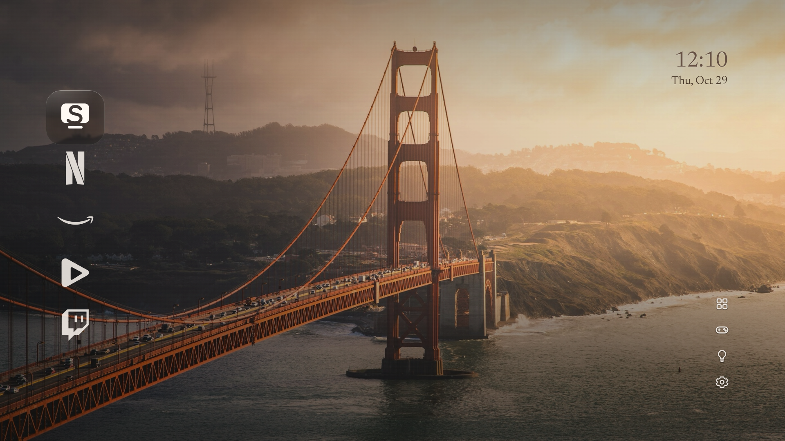
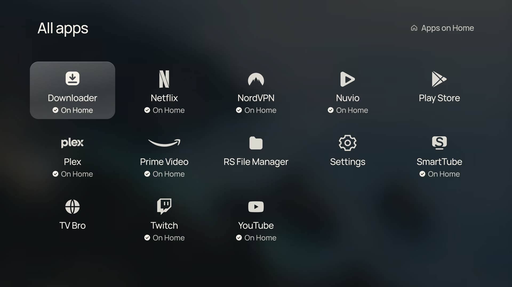
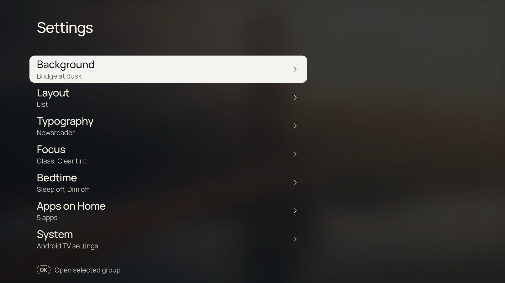

# CleanFrame TV

A clean, fast home screen for Android TV / Google TV boxes, built as a WebView
launcher. No recommendations, no sponsored rows — a dock of your apps, a clock, and
settings that stay out of the way.

This is the **base build**: no device-specific extras (no smart-light integration,
no game-mode shortcuts). Those belong in your own fork — see `docs/EXTENDING.md`.



*Screenshots come from the author's build, which adds two extra utility buttons in the
top-right row. The base ships with All apps and Settings only.*

## What it does

- **Dock or list layout** with horizontal scrolling and a focus plate
- **All apps** — lists every installed app, including sideloaded APKs that only
  declare `CATEGORY_LAUNCHER`. New installs appear without a restart.
- **Monochrome marks** for common streaming apps, with a letter fallback for the rest
- **Settings**: background (photo/light/dark), layout, typography, focus style,
  app display (icons / text / both), and the home-app editor
- **Wallpaper picker** with 15 bundled photos and timed rotation
- **Clock** with optional date line and 12/24-hour toggle
- **Config export/import** to `Download/cleanframe-config.json`, plus a
  last-known-good backup so a bad read can't wipe your layout
- Runs fully offline: **no `INTERNET` permission**





## Requirements

- Android TV / Google TV device, **Android 8.0 (API 26)** or newer
- Built and tested on Android 14 (API 34), 1920×1080
- JDK 17, Android SDK 34, Gradle

## Build

```bash
export JAVA_HOME=/path/to/jdk17
export ANDROID_HOME=/path/to/android-sdk
echo "sdk.dir=$ANDROID_HOME" > local.properties
gradle assembleDebug
```

The APK lands in `app/build/outputs/apk/debug/app-debug.apk`.

## Install

```bash
adb connect <device-ip>:5555
adb install -r app/build/outputs/apk/debug/app-debug.apk
```

Make it the launcher (Android TV honours this natively — no hacks needed):

```bash
adb shell cmd package set-home-activity --user 0 dev.riley.cleanframe/.MainActivity
adb shell cmd role add-role-holder --user 0 android.app.role.HOME dev.riley.cleanframe
```

Fire OS does **not** allow this; its launcher is a protected package. Fork and adapt
if you need that platform.

## Changing the app id

`app/build.gradle` → `applicationId`. Change it to your own namespace before
installing alongside another build.

## Remote keys

| Key | Action |
|---|---|
| D-pad | Move focus |
| OK | Launch / activate |
| Back | Up one level |
| Double-press Back | Open CleanFrame Settings |

## Credits

The interface is a port of **CleanFrame** by Nathan Clark (MIT). See `LICENSE` and
`THIRD_PARTY_NOTICES.md` for the licence text and bundled asset sources.

## Extending

See `docs/EXTENDING.md` for the bridge API, how to add app marks, and where to hang
your own features.
